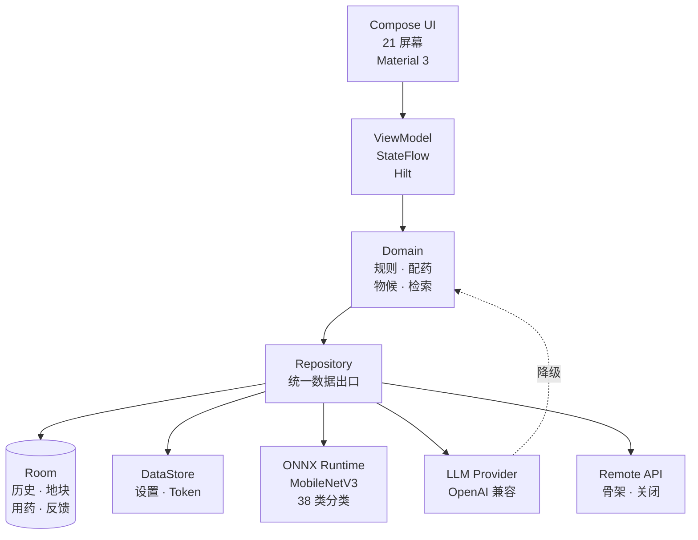
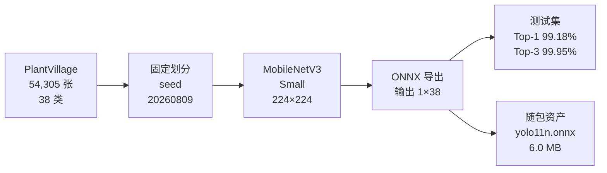

<div align="center">

# 农智眼 · AgroVision

**端侧作物病害识别与农事决策系统**　·　Android　·　ONNX Runtime　·　离线优先

[](https://github.com/ououlin/AgroVision/releases)
[](LICENSE)
[](#概览)
[](#技术栈)
[](#技术栈)
[](#模型与数据)
[](#模型与数据)
[](#架构)
[](https://github.com/ououlin/AgroVision/actions/workflows/android.yml)

<sub>145 个 Kotlin 文件 / 23,484 行　·　21 个屏幕分包　·　41 个单元测试　·　文档更新 2026-11-20</sub>

</div>

---

拍照识别 → 行动式问诊 → 病虫百科 → 植保配药 → 地块用药记录 → 农情提醒，把一条农事闭环压进一个 APK。识别、检索、配药、提醒全部本地完成，大模型只做增强、不做依赖。

## 目录

| 章节 | 内容 |
|:--|:--|
| [概览](#概览) | 项目规模、形态与关键指标 |
| [架构](#架构) | 分层结构、数据流与设计取舍 |
| [核心能力](#核心能力) | 功能矩阵与离线可用性 |
| [模型与数据](#模型与数据) | 网络结构、训练口径、随包资产 |
| [技术栈](#技术栈) | 逐项版本（对齐 Version Catalog） |
| [工程结构](#工程结构) | 目录树与包职责 |
| [快速开始](#快速开始) | 环境、构建、测试、签名 |
| [质量与验证](#质量与验证) | 41 个用例分布与回归口径 |
| [功能开关](#功能开关) | `FeatureFlag` 现值与语义 |
| [路线图](#路线图) | V1 / V2 / V3 能力边界 |
| [已知限制](#已知限制) | 指标口径与未闭环模块 |
| [仓库内容说明](#仓库内容说明) | 哪些内容不入库、为什么 |
| [文档](#文档) | 交付材料与仓库的分工 |
| [许可证](#许可证) | MIT |

## 概览

| 维度 | 现状 |
|:--|:--|
| 形态 | 单 APK，`com.agrovision.app`，`minSdk 26` / `targetSdk 35` / `compileSdk 35` |
| 版本 | `versionName 2.0.0`（`versionCode 20000`），对外叙事以 `app/build.gradle.kts` 为准 |
| 识别 | 随包 MobileNetV3-Small（ONNX，`1×38` 分类），推理不依赖网络 |
| 交互 | Jetpack Compose + Material 3，21 个屏幕分包 |
| 规模 | 145 个 `.kt`（主代码 135 / 测试 10）、23,484 行 |
| 模型指标 | PlantVillage color 固定测试集 Top-1 `99.1808%`、Top-3 `99.9511%` |
| 依赖治理 | Version Catalog 统一收敛，`gradle/libs.versions.toml` 为唯一版本源 |

> **设计前提**：目标用户是基层农技员与小农户——网络不可靠、设备中低端、病害名与药名存在方言差异。因此产品把「能不能离线跑完」当作硬约束，而不是体验优化项。

## 架构

自上而下四层，**Domain 层是纯 Kotlin**，不依赖 Android 框架，可直接在 JVM 上跑单元测试。



**四条硬约束**

1. **分层即边界** —— `ui/` 只依赖 `ViewModel` 暴露的状态，`data/` 的具体实现（Room、DataStore、ONNX、HTTP）不外泄，UI 层拿不到 `Context` 以外的存储细节。
2. **降级在边缘发生** —— LLM 调用失败、未配置 Key、或用户处于飞行模式时，由 `domain/` 的规则引擎接管，输出结构不变，只是文案来源从模型换成规则库。
3. **门控式演进** —— V3.0 模块代码保留但 `FeatureFlag` 常量化关闭，导航与入口同时收口，避免"半成品可见"。
4. **可核对的资产** —— 随包模型附带 `model_meta.json`（输入尺寸、均值方差、38 类标签、测试指标、SHA-256），离线也能核对版本，不依赖服务端下发。

## 核心能力

| 能力 | 实现要点 | 离线 |
|:--|:--|:--:|
| **病害识别** | CameraX 取帧 → 224×224 / ImageNet 归一化 → ONNX 推理 → softmax Top-3，附置信度阈值策略 | ✅ |
| **行动式问诊** | 结果按「今天先做 / 原因 / 用药参考 / 复查时间」四段式组织；LLM 不可用时降级本地规则引擎 | ✅ / 🌐 |
| **病虫百科** | 本地知识库 74 条目，其中 26 条带真实 PlantVillage 示例图；中英文检索 | ✅ |
| **农技搜索** | 同义词 + 拼音首字母 + 意图分类，只走 `KnowledgeBase`，**不调用 LLM** | ✅ |
| **植保配药** | 按产品登记标签计算总药量、总用水与分桶配比，结果可写入地块用药记录 | ✅ |
| **个人农场** | 地块管理、用药记录、安全间隔期倒计时、采收提醒（WorkManager 本地调度） | ✅ |
| **历史与备份** | Room 四表 JSON 手动导出/导入，系统自动云备份关闭 | ✅ |
| **隐私门闩** | 用户明示同意后才初始化认证流程、注册后台提醒、进入业务页 | ✅ |
| **多轮问农技** | 可从问诊结果携带上下文继续追问；离线保留基础交流与农业知识问答 | ✅ / 🌐 |

## 模型与数据

| 项 | 值 |
|:--|:--|
| 架构 | MobileNetV3-Small，分类头输出 `1×38` |
| 输入 | 224×224 RGB，mean `[0.485, 0.456, 0.406]`，std `[0.229, 0.224, 0.225]` |
| 类别 | PlantVillage color 38 类 / 14 种作物 |
| 数据规模 | 54,305 张，固定随机划分 `seed 20260809`，train / val / test = 70 / 15 / 15 |
| 测试指标 | Top-1 `99.1808%`，Top-3 `99.9511%`（同分布受控叶片图像） |
| 随包文件 | `app/src/main/assets/model/yolo11n.onnx`，6.0 MB（文件名沿用历史命名，实为分类模型） |
| 权重校验 | SHA-256 `41643BD279F3221B810B7500E8596D801ABA2084F93010C687D9F00109F38FCF` |



> **指标口径**：以上是同分布、受控光照下的叶片图像测试结果，**不能替代真实田间外部验证**。训练与导出脚本在 `tools/`；训练流程、数据来源与许可台账属交付材料，保留在本地 `docs/`，不随仓库发布（见「文档」与「仓库内容说明」）。

训练侧权重（`best.pt` 与训练用导出 ONNX，合计约 12 MB）不进 Git 历史，见 [Release v2.0.0](https://github.com/ououlin/AgroVision/releases/tag/v2.0.0)。

## 技术栈

| 层 | 组件 | 版本 |
|:--|:--|:--|
| 语言 / 构建 | Kotlin · AGP · KSP | `2.0.21` · `8.7.0` · `2.0.21-1.0.28` |
| UI | Compose BOM · Material 3 · Navigation Compose | `2024.09.03` · — · `2.7.6` |
| 依赖注入 | Hilt · hilt-navigation-compose | `2.52` · `1.1.0` |
| 持久化 | Room · DataStore Preferences · Security Crypto | `2.6.1` · `1.0.0` · `1.1.0-alpha06` |
| 推理 | ONNX Runtime Android · TensorFlow Lite | `1.17.1` · `2.13.0` |
| 相机 | CameraX（core / camera2 / lifecycle / view） | `1.4.1` |
| 网络 | Retrofit · OkHttp | `2.9.0` · `4.12.0` |
| 文字识别 | ML Kit Text Recognition（中英） | `16.0.0` |
| 后台调度 | WorkManager · Hilt Work | `2.9.1` · `1.2.0` |
| 辅助 | Coil · Timber · Gson | `2.5.0` · `5.0.1` · `2.10.1` |

## 工程结构

```text
AgroVision/
├── app/                             # 唯一 Android 模块（插件：AGP + Kotlin + Compose + Hilt + KSP）
│   └── src/
│       ├── main/java/com/agrovision/app/
│       │   ├── config/              # FeatureFlag：版本级功能开关
│       │   ├── data/                # 数据层
│       │   │   ├── local/           #   Room DAO / DataStore / EncryptedSharedPreferences
│       │   │   ├── repository/      #   仓库实现（UI 唯一数据入口）
│       │   │   ├── diagnosis/       #   本地诊断规则引擎
│       │   │   ├── llm/             #   LLM Provider（OpenAI 兼容）与管理器
│       │   │   ├── rag/             #   KnowledgeBase 检索
│       │   │   ├── advisor/         #   物候 / 天气 / 提醒规则
│       │   │   ├── remote/          #   Retrofit 接口与元数据同步骨架
│       │   │   ├── agent/           #   多智能体编排（V3.0，关闭）
│       │   │   ├── ocr/             #   OCR 处理（实验入口关闭）
│       │   │   └── robot/           #   巡检机器人（V3.0，关闭）
│       │   ├── domain/              # 纯 Kotlin：模型、规则、计算（无 Android 依赖）
│       │   ├── di/                  # Hilt 模块
│       │   ├── ml/                  # ONNX / TFLite 检测器与结果策略
│       │   ├── network/             # 鉴权拦截器与 Token 刷新
│       │   ├── ui/                  # Compose：theme / components / navigation / screen
│       │   └── util/                # 缓存、日志收集
│       ├── main/assets/             # encyclopedia.json、model/（onnx + labels + meta）
│       ├── test/                    # 9 个 JVM 单元测试类
│       └── androidTest/             # Instrumentation 测试
├── gradle/
│   ├── libs.versions.toml           # Version Catalog：全仓唯一版本源
│   └── wrapper/                     # Gradle Wrapper 8.9
├── tools/                           # 训练 / 导出 / 数据准备（Python + PowerShell）
├── backend/supabase/                # 表结构、RLS 策略与 RPC（生产后端未上线）
├── .github/workflows/               # CI：单测 + assembleDebug + schema 快照校验
├── CHANGELOG.md                     # 版本变更记录（按日期倒序）
├── .gitignore / .gitattributes      # 入库过滤规则与行尾策略
└── LICENSE
```

> `docs/`（项目说明书、用户手册、训练指南、数据台账）为交付材料，本地保留，不入库。
>
> `app/schemas/` 是 KSP 导出的 Room schema 快照，与 `AppDatabase.version` 一起入库；迁移改动以它为准，CI 会校验它是否与实体定义漂移。

包规模：`ui` 57 · `data` 48 · `domain` 12 · `di` 6 · `ml` 5 · `network` 2 · `util` 2 · `config` 1 · 根级 2（Kotlin 文件数）。

## 快速开始

### 环境要求

- JDK 17、Android Studio Ladybug 或更新
- Android SDK 35（`minSdk 26`）
- Python 3.10+（仅训练 / 转换模型时需要）

### 构建与测试

```bash
./gradlew :app:assembleDebug     # Debug APK
./gradlew test                   # JVM 单元测试（41 个用例）
./gradlew :app:assembleRelease   # Release（需签名，见下）
```

### 依赖仓库

默认直连 `google()` / `mavenCentral()` / `gradlePluginPortal()`，公共 CI 与陌生环境都能直接复现。国内网络可显式开启阿里云镜像：

```bash
./gradlew :app:assembleDebug -PcnMirror=true
# 或 export AGROVISION_CN_MIRROR=true
```

> 镜像默认关闭是有意为之：`maven.aliyun.com/repository/public` 只代理 Maven Central，Google 系制品要走 `/repository/google`，混用时会产生大量 404 日志；且境外 runner 访问该镜像会直接拖垮插件解析。
>
> 切换仓库源会让 Gradle 的按仓库分区缓存失效，首次构建需要联网重新解析一次。

首次构建需自行创建 `local.properties`：

```properties
sdk.dir=D:\...\Android\Sdk
```

### 持续集成

`.github/workflows/android.yml` 在每次 push / PR 上执行，同分支并发会互相取消：

| 步骤 | 命令 | 作用 |
|:--|:--|:--|
| 单元测试 | `./gradlew :app:testDebugUnitTest` | 41 个 JVM 用例 |
| 构建 | `./gradlew :app:assembleDebug` | 产出可安装 APK，artifact 保留 14 天 |
| schema 校验 | `git diff --exit-code app/schemas` | 改了表结构却没提 schema 快照时直接失败 |

### 工具脚本的数据路径

`tools/` 下的脚本不再硬编码本机路径，按仓库相对位置 + 环境变量解析：

| 环境变量 | 默认值 | 用途 |
|:--|:--|:--|
| `AGROVISION_DATASET` | `~/agrovision_dataset` | 训练 / 导出用的 ImageFolder 数据集 |
| `AGROVISION_ARCHIVE` | `~/plantvillage/archive.zip` | PlantVillage 原始压缩包 |
| `AGROVISION_COLOR_OUT` | `~/plantvillage/color_archive` | 解压后的 color 变体目录 |

模型转换脚本（`convert_*.py` / `export_onnx11.py`）的 `os.chdir` 目标也改为按脚本位置反推 `app/src/main/assets/model`。

### Release 签名（上架前必做）

未配置正式 jks 时，`assembleRelease` 会回落到 debug 签名，**产物不可上架**，仅用于本地混淆/崩溃自查。构建脚本会主动拦截"用 debug 密钥打发布包"：未提供四项配置时 `packageRelease` / `signReleaseBundle` 直接失败。

```properties
# gradle.properties 或同名环境变量
KEYSTORE_FILE=/path/to/release.jks
KEYSTORE_PASSWORD=****
KEY_ALIAS=agrovision
KEY_PASSWORD=****
```

## 质量与验证

41 个 JVM 用例分布在 9 个测试类，集中在**可被纯逻辑验证**的部分（算法、映射、策略、计算），不依赖真机与网络。CI 在每次 push / PR 上跑这套用例 + `assembleDebug`，并校验 Room schema 快照未漂移。

| 测试类 | 用例 | 覆盖点 |
|:--|:--:|:--|
| `ml/AlgorithmTest` | 12 | softmax 归一化与溢出、sigmoid 单调性、IoU、坐标换算与边界裁剪 |
| `data/repository/LabelMapTest` | 6 | 38 类标签表、中文映射、未知标签回退、健康类括号写法 |
| `ml/DetectionResultPolicyTest` | 4 | 作物类映射、自动模式不限制类别、背景类过滤 |
| `util/CacheManagerFormatTest` | 4 | 容量格式化（B / KB / MB / GB） |
| `data/diagnosis/LocalQuestionMatcherTest` | 3 | 离线问句匹配、病虫害名提取、默认建议 |
| `data/llm/OfflineConversationTest` | 3 | 离线对话兜底、能力问答、农业问题下探知识引擎 |
| `domain/advisor/SprayCalculatorTest` | 3 | 整桶 / 尾桶配药计算、非法输入拒绝 |
| `domain/model/PesticideCatalogTest` | 3 | 农资目录唯一性、推荐成分置顶、按防治对象检索 |
| `domain/model/EncyclopediaImageCatalogTest` | 3 | 标签→本地图映射、历史标签归一化、不张冠李戴 |

> **回归口径**：对外引用的指标与测试结论，以本地项目说明书 `docs/PROJECT_MANUAL.md`（不随仓库发布）为准；未在测试产物中留存原始记录的数字，不得用于报名材料、测试报告或答辩。

## 功能开关

`config/FeatureFlag.kt` 是版本能力的唯一开关点，UI 入口与后台任务共用同一组布尔值。

| 开关 | 默认 | 语义 |
|:--|:--:|:--|
| `isV2FarmEnabled` | ✅ | 个人农场：地块、用药记录、结构化绑定 |
| `isV2AdvisorEnabled` | ✅ | 农情顾问：物候 + 病害预警 + 安全间隔期 |
| `isV2AgriSearchEnabled` | ✅ | 农技搜索入口（RAG only，不调 LLM） |
| `isV2DualModelEnabled` | ✅ | 双头模型路由（分类 + 检测） |
| `isV2AccountEnabled` | ❌ | 手机号 + 短信登录；关闭时回落硬编码游客模式 |
| `isV2CloudSyncEnabled` | ❌ | 仅同步元数据（不含原图，缩略图 ≤ 200×200） |
| `isV2GradualRollout` | ❌ | 灰度发布（`BuildConfig.GRADUAL_ROLLOUT_PERCENT`） |
| `isV3Enabled` | ❌ | V3.0 智慧平台（GIS / 巡检 / 告警 / 监控） |
| `isOcrEnabled` | ❌ | OCR 入口（依赖已引入，产品上让位于知识库检索） |

## 路线图

| 版本 | 状态 | 边界 |
|:--|:--:|:--|
| 1.0.0 | ✅ | 核心闭环：拍照识别 → AI 诊断 → 病虫百科 → 历史记录 |
| 2.0.0 | ✅ 当前 | 本地个人农技顾问：农场、用药、农技搜索、农情提醒、手动备份；账号与云同步不开 |
| 3.0.0 | 🔬 规划 | 智慧平台：多智能体编排、巡检中心、GIS、告警、监控、OCR、巡检机器人 |

> V3.0 相关代码因历史命名保留在仓库中，`FeatureFlag.isV3Enabled = false`，功能未闭环，不构成对外承诺。

## 已知限制

- **文件名 ≠ 架构**：`model/yolo11n.onnx` 输出维度是 `[1, 38]`，实为 MobileNetV3-Small 分类模型，不提供目标框。`PestDetector` 已接入但独立害虫检测资产 `model/pest_detector.onnx` 尚未随包发布。
- **指标边界**：99.18% / 99.95% 来自同分布受控测试集，田间实拍（逆光、遮挡、多叶混拍）表现未做外部验证。
- **账号与云同步**：2.0.0 首发关闭。客户端按"不传原图、只传元数据"保留，需完成生产 API、短信服务、服务端账号删除与安全验收后方可开放。
- **占位实现**：`AgentOrchestrator.getSystemStatus()` 等 V3.0 模块含示例数据字段，不代表真实系统状态。

## 仓库内容说明

为控制体积，下列内容保留在本地、不进入 Git：

| 未入库内容 | 说明 |
|:--|:--|
| `app/build/`、`build/`、`.gradle/` | Gradle 构建产物与缓存，`./gradlew assembleDebug` 可重建 |
| `local.properties` | 本机 Android SDK 路径，按 `sdk.dir=D:\...\Sdk` 自行创建 |
| `app-*.apk` | 安装包（Debug / Release），由构建生成 |
| `tools/agrovision_cls/` | 训练权重与导出模型，见 [Release v2.0.0](https://github.com/ououlin/AgroVision/releases/tag/v2.0.0) |
| `docs/` | 项目说明书、用户手册、训练指南、数据台账、参赛方案，仅本地保留 |
| `competition/` | 比赛材料（说明文档、模型卡、测试报告草稿、提交清单、官方通知），仅本地保留 |
| `SHA256SUMS.txt` | 提交校验用临时清单，随文件集变化失效 |

## 文档

项目说明书、用户手册、模型训练指南、数据来源台账、上线检查清单、参赛方案与比赛材料属于交付材料，**保留在本地 `docs/`、`competition/` 目录，不随仓库发布**（已在 `.gitignore` 中忽略）。仓库只保留可复现的部分：

| 内容 | 位置 |
|:--|:--|
| 训练 / 导出 / 数据准备脚本 | `tools/` |
| 随包模型、标签与元数据 | `app/src/main/assets/model/` |
| 表结构、RLS 策略与 RPC | `backend/supabase/` |
| 版本变更记录（按日期倒序） | [`CHANGELOG.md`](CHANGELOG.md) |

## 许可证

本项目采用 [MIT 许可证](LICENSE)。Copyright (c) 2026 ououlin。

任何人都可以自由使用、修改、分发本项目代码（含商业用途），只需在副本或衍生作品中保留上述版权声明与许可证全文。数据集与模型权重的来源及授权状态见本地 `docs/DATA_PROVENANCE.md`（不随仓库发布），不因本许可证而改变。
