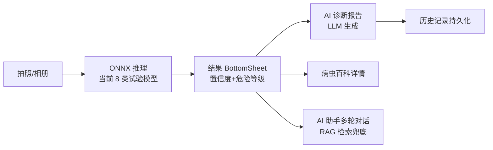
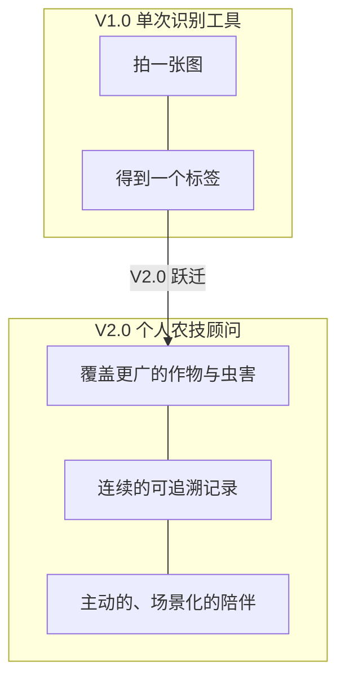
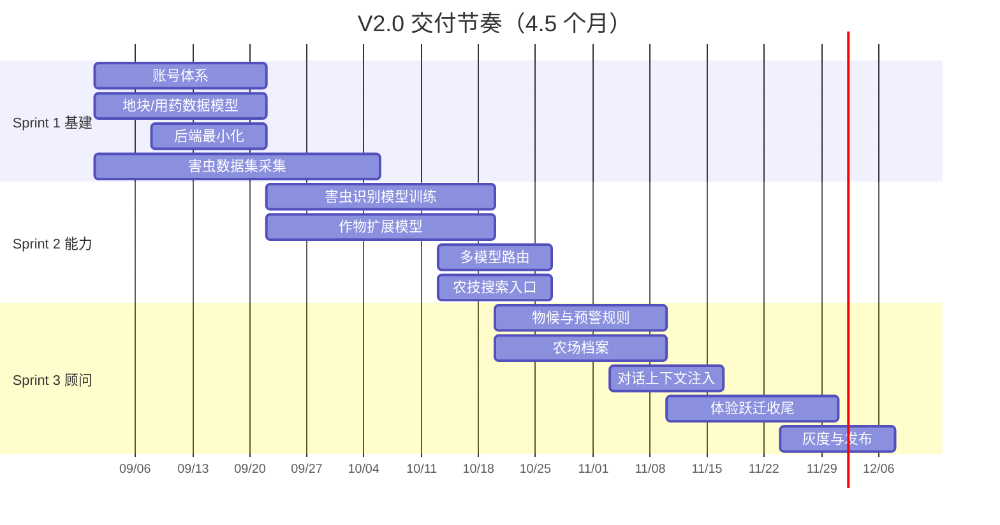

# AgroVision V2.0 进展与收尾文档

> **定位**：从「单点工具」到「个人农技顾问」的价值跃迁
>
> 版本号：2.0.0 ｜ 当前代码状态：功能主干已接入，模型与云端仍按降级/骨架策略运行
>
> 文档状态：Release Candidate Review ｜ 最后更新：2026-08-05 ｜ 作者：产品组/工程组

---

## 0. 当前实现概览（2026-08-05）

V2.0 已进入首发上线检查阶段。当前仓库的 `versionName` 为 `2.0.0`。农场、搜索、AI 助手、顾问提醒和手动备份开启；生产账号服务尚不可用，因此账号与云同步首发关闭；V3.0 智慧平台能力继续关闭。

| 模块 | 当前状态 | 说明 |
|---|---|---|
| 农户任务界面 | P0 已整改 | 底部导航调整为“首页/问诊/农事/我的”；首页以拍照问诊为主任务，问诊结果优先展示行动与安全信息。 |
| 本地身份与隐私门闩 | 首发启用 | `privacyAgreed` 先于认证初始化和后台任务注册；使用稳定的本地用户身份，不展示手机号登录入口。 |
| 我的农场 | 已接入 | Room v5 新增 `plots`、`treatments`，首页有“我的农场”入口，支持地块创建、详情、用药记录。 |
| 农技搜索 | 已接入 | 独立入口走 `KnowledgeBase`，支持同义词、拼音首字母、意图分类，离线可用。 |
| 农情顾问 | 已接入规则骨架 | 物候、天气预警、采收/安全间隔期提醒已接入 WorkManager；实际提醒质量依赖地块与用药数据完整度。 |
| AI 助手个性化 | 已接入 | 支持日常对话与多轮上下文；农业问题按需启用 RAG，农场摘要作为 system context 注入，离线走基础会话与本地规则。 |
| 双头模型路由 | 代码已接入，资产降级 | `ModelRouter` 会优先初始化 Disease + Pest；当前随包未包含 `pest_detector.onnx` 时自动降级为 MobileNetV3/ONNX 单头。 |
| 账号与云同步 | 首发关闭 | 客户端骨架保留；生产 API、短信、服务端账号删除与安全验收完成前不得打开功能开关。 |
| 数据备份 | 已接入 | `BackupRepository` 支持 V2 四表 JSON 导出/导入。 |
| V3.0 GIS/巡检/机器人 | 保留但关闭 | 相关 UI/Agent/Robot 仍是实验代码，不作为 V2.0 可用承诺。 |

### 本轮收尾修复

- 按农户任务重构首页、底部导航、相机引导、问诊结果和问农技入口。
- 普通页面隐藏模型、Provider、API Key、CPU、输入尺寸和置信度百分比等技术信息。
- 问诊结果新增自然语言判断程度、“今天先做”、复查提示和用药安全提醒。
- 问诊结果可携带当前病害上下文进入“问农技”，避免用户重复描述。
- 移除图片/语音“即将上线”等无效控件，未完成能力不在首发界面占位。
- `compileDebugKotlin` 已通过；`testDebugUnitTest` 仍受测试 KSP `EOFException` 阻塞，保留为干净 CI 上线门禁。

- 修复 `DetectionRepository` Hilt 提供方法与构造函数参数不一致的问题。
- 修复 `ChatViewModel` 使用 `viewModelScope.async` 但缺少协程导入的问题。
- 修复设置页引用不存在的 `FeatureFlag.isCloudSyncEnabled`，统一为 `isV2CloudSyncEnabled`。
- 修复业务请求认证拦截器错误依赖 `isV3Enabled`，改为 V2 账号开关。
- 修复 LLM 诊断/RAG 使用启动时旧配置的问题，改为由 `LlmManager` 传入当前运行配置。
- 修复 `.gitignore` 中 `nul}` 导致 `rg` 解析失败的问题。
- 禁止 Room 缺失迁移时清库，Release 产物缺少正式签名时直接失败。
- 区分 Debug/Release 网络安全策略，Release 禁止本地明文 HTTP。
- 后台提醒改为隐私同意后注册，并接入 `HiltWorkerFactory`。
- 移除电话状态与存储权限，关闭系统自动云备份，修复 ONNX 输入张量泄漏。

---

## 一、V1.0 现状复盘（决定 V2.0 取舍的依据）

### 1.1 已验证的核心闭环



### 1.2 V1.0 的「三个硬伤」（V2.0 必须正面回应）

| 硬伤 | 现状证据 | 用户感知 |
|---|---|---|
| **覆盖窄** | 随包 ONNX 实际仅输出 8 类，覆盖苹果、蓝莓、樱桃及无叶背景；39 项知识标签不能代表模型能力 | 大多数作物无法识别，比赛前必须重训并用独立测试集验收 |
| **只识病害、不识虫害** | 模型标签全是 `Crop___Disease` 结构，无独立害虫类目；`PestInfo.category` 默认 `"病害"`，知识库 pesticide 字段虚化 | 农户最高频的虫害（蚜虫、红蜘蛛、食心虫、青虫）无法识别，知识库里 `KnowledgeBase.synonymMap` 倒是有害虫同义词，但模型不输出 |
| **纯离线孤岛** | V1.0 无账号体系、`SyncService` 未闭环、`FeedbackRepository` 只入本地 Room | V2.0 已补账号/游客、农场结构、备份与同步骨架；后端部署后才能完整换机恢复 |

### 1.3 已有但被 FeatureFlag 关闭的资产（V2.0 可选择性激活）

- `LocalDiagnosisEngine`（34KB，规则引擎完整）— 可作为离线诊断增强
- `WeatherRepository` + 和风天气 + wttr.in 双源 — 已具备天气农情联动能力，但首页只展示不联动
- `KnowledgeBase` 同义词扩展 + 拼音首字母 + 意图分类 — 检索能力被严重低估，V2.0 可产品化
- `AgentOrchestrator` + 三个 Agent — 流水线骨架已有，但 V2.0 保持关闭，留给 V3.0

### 1.4 明确不做的（避坑）

- ❌ **不做** V3.0 的 GIS / 巡检机器人 / 告警中心 — 面向 B 端大农场，V2.0 用户基数还不够
- ❌ **不做** 多智能体全量编排 — 当前 Agent 全是 stub，强行上线只会透支信任
- ❌ **不做** 云端模型推理 — 离线优先是差异化壁垒，云端推理违背隐私叙事

---

## 二、V2.0 产品主题与北极星

### 2.1 版本主题：**「覆盖 × 连续 × 陪伴」**



### 2.2 北极星指标（NSM）

**「周活跃识别 → 周活跃顾问触达率」**

- V1.0 只看「识别次数」，是工具指标
- V2.0 改看「每周使用过 识别 / 诊断 / 问答 / 农情提醒 任一能力的用户占比」，是顾问指标
- 目标：从 V1.0 的「月打开 3–5 次」提升到「周打开 3+ 次」

---

## 三、用户分层与场景

V2.0 聚焦两类**已被验证有付费意愿**的用户：

| 画像 | 主体 | 核心场景 | V2.0 关键诉求 |
|---|---|---|---|
| **老张型** | 45–60 岁果园主，2–20 亩 | 发现叶/果异常 → 拍照 → 求快速用药方案 | 覆盖广、离线可用、用药方案可直接转发给农资店 |
| **小李型** | 30–45 岁新农人/合作社技术员 | 巡园 → 批量记录 → 月度复盘 → 决策施肥打药 | 历史可追溯、按地块管理、趋势可视化 |

**明确放弃**：B 端大型基地管理者（留给 V3.0 智慧平台）。

---

## 四、V2.0 四大特性（Epics）

### Epic 1：识别能力扩展 — 从 8 类试验模型到可验证的多作物病虫草害

**Why**：覆盖窄是 V1.0 流失的首要原因，用户拍 3 次有 2 次「未检测到」就直接卸载。

**Scope**

| 子能力 | 说明 | 验收标准 |
|---|---|---|
| 作物扩展 | 标签目录已扩展到 V2.0 四维目录；当前随包模型仍以 PlantVillage/ONNX 资产为主 | 新模型发布前 UI/百科可识别扩展目录，推理仍受随包模型限制 |
| **害虫识别** | 独立训练害虫检测头：蚜虫、红蜘蛛/叶螨、食心虫、介壳虫、天牛、金龟子、菜青虫、潜叶蝇、白粉虱、烟青虫 | `PestDetector` 已接入；缺少 `model/pest_detector.onnx` 时自动降级 |
| 草害识别（可选） | 稗草、马唐、狗尾草、藜、苋 5 类常见杂草 | 非必做，视训练数据进度 |
| 多模型路由 | 新增 `PestDetector` 与 `DiseaseDetector` 双头，按图像内容路由；保留 MobileNetV3 作轻量分类、YOLO11n 作检测 | 代码已接入；真实性能需待害虫模型资产随包后重新测试 |
| 置信度校准 | 引入温度缩放（Temperature Scaling）校准，解决「自信但错」问题 | ECE ≤ 0.05；低置信度时主动引导「换个角度重拍」 |

**技术要点**

- 训练数据集扩充：`tools/plant_dataset/` 当前为空，需对接公开数据（IP102 害虫数据集、PlantDoc、AI Challenger 农作物病害）+ 自采标注
- 模型文件从 5.84MB → 预计 12–15MB（双头 ONNX）；当前版本采用“缺害虫模型自动降级”策略，避免阻塞 2.0 发布
- `PlantDiseaseLabels.LABEL_MAP` 重构为 `PestLabelCatalog`，按 `crop / type(disease/pest/weed) / cnName / enName / ICD-code-like` 四维组织

**不做**：不做云端大模型兜底识别，保持离线差异化。

---

### Epic 2：个人农场模型 — 地块、作物、记录的结构化

**Why**：解决「换机即丢」与「无法复盘」两大痛点，同时为 V3.0 B 端打数据地基。

**Scope**

| 子能力 | 说明 | 验收标准 |
|---|---|---|
| 账号体系（轻量） | 手机号 + 短信验证码登录；游客模式保留 | 客户端已接入；真实短信登录依赖后端 API 可用性 |
| 地块管理 | 用户可创建多个「地块」：名称、面积、作物类型、经纬度（可选） | 已落地 Room/Repository/UI |
| 识别关联地块 | 记录层支持 `plotId`，老数据可为空 | UI 选择地块仍需继续完善为默认上次地块/拍照前选择 |
| 地块看板 | 每个地块独立的时间线：识别历史、病害发生频次、用药记录 | 基础详情与用药时间线已接入 |
| 用药记录 | 药剂、用量、施用日期、安全间隔期、预计采收日期 | 已落地，并接入采收提醒 Worker |
| 本地优先 + 可选云同步 | Room 仍是主数据源；登录后按地块增量同步到后端，只传元数据，不传原图 | 客户端骨架已落地；后端部署后验证换机恢复 |

**技术要点**

- 复用 V1.0 已有的 `HistoryEntity`、`HistoryDao`，新增 `PlotEntity`、`TreatmentEntity`、`PlotDao`、`TreatmentDao`
- 后端只做极简：账号 + 元数据同步，**不存原图**（隐私叙事一致性）；当前提供 Supabase schema 与 REST/RPC 映射文档
- `allowBackup` 从 `false` 改为 `true` + `fullBackupContent` 白名单，配合应用内导入/导出 JSON

**不做**：不做 B 端多角色协作，不做地块的 GIS 多边形绘制（留给 V3.0）。

---

### Epic 3：场景化农情顾问 — 从被动问答到主动陪伴

**Why**：V1.0 的 AI 助手是「你问我答」，用户用完即走；V2.0 要变「我记得你的农场，主动提醒」。

**Scope**

| 子能力 | 说明 | 验收标准 |
|---|---|---|
| 农场档案 | 基于地块作物 + 历史识别 + 用药记录，自动构建「农场画像」摘要 | 已接入聊天欢迎语与 system 上下文 |
| **物候提醒** | 按作物物候期（萌芽、开花、座果、膨大、着色、采收）推送管理要点 | 规则引擎与调度 Worker 已接入 |
| **病害预警** | 基于天气（温湿度、降雨）+ 作物易感期，主动推送风险建议 | 规则骨架已接入，仍需田间数据校准 |
| 用药安全间隔期提醒 | 用药记录自动倒计时，采收前提醒 | 已接入 `HarvestReminderWorker` |
| 对话上下文记忆 | `ChatViewModel` 当前 `maxHistory=20`，V2.0 引入「农场摘要」注入 system prompt | 已接入，并修复协程导入问题 |
| 知识库检索升级 | 把 `KnowledgeBase` 同义词 + 拼音 + 意图分类能力做成「农技搜索」入口 | 已接入首页独立入口 |

**技术要点**

- `KnowledgeBase` 已经是隐藏资产，V2.0 给它一个**独立入口**「农技搜索」放在首页，与 AI 助手区分：助手=生成式，搜索=检索式（RAG only，不调用 LLM，离线可用）
- 物候表需要农业知识建模：按作物 × 物候期 × 管理动作三张表，冷启动用规则表 + 专家校对，后期再考虑 LLM 生成
- 预警算法：基于 `WeatherRepository` 已有天气数据 + 简单病害-气象耦合模型（如马铃薯晚疫：15–20℃ + 高湿 48h），冷启动用 5–8 条规则即可
- 推送通道：WorkManager + 本地通知，**不上 FCM**（避免引入 Google 依赖，国产机兼容性差）

**不做**：不做「农技社区」、不做专家 1v1 问诊（模式重，留存差）。

---

### Epic 4：体验跃迁 — 把 V1.0 的「能用」变「好用」

**Why**：V1.0 在工程上有不少好底子（权限 Rationale、Compose 全量、WebP 优化），但体验细节仍有明显短板，V2.0 要收尾。

**Scope**

| 子能力 | 现状问题 | V2.0 方案 |
|---|---|---|
| 识别结果可解释 | 只给置信度，用户不知道模型为啥这么判 | 输出 Grad-CAM 热力图叠加 + Top-3 候选标签，让用户看模型「看哪」 |
| 诊断报告结构化 | 当前纯文本 Markdown | 输出 PDF + 可转发图片版（复用 `output/doc/` 已有的 docx 管线） |
| 离线模式透明 | 用户不知道为啥 AI 不答了 | 离线时在助手页明确状态条 + 引导去设置配 Key |
| 首页信息密度 | V1.0 首页卡片多但无个性 | 「我的农场」首屏化：地块状态卡 + 待办提醒 + 最近识别合并为一条流 |
| 深色模式完善 | 主题已有，但部分硬编码 `Color.Black` 在深色下不和谐 | 全量替换 `accentOrange()` 等硬色为 `SemanticColors` |
| 性能基线 | V1.0 已开 incremental + cache，但冷启动仍慢 | 冷启动 ≤ 1.5s（中端机）；识别响应 ≤ 300ms |

**不做**：不做平板专属布局、不做 Wear OS（场景不成立）。

---

## 五、Sprint 排期（建议节奏）



> 进度说明：当前仓库已提前完成 Sprint 1 与 Sprint 3 中的多项客户端骨架；模型训练、害虫资产随包、云端部署与线上指标仍按后续发布节奏推进。

---

## 六、关键取舍与风险

### 6.1 必须坚持的原则

1. **离线优先不破**：模型、知识库、规则引擎都在本地，云只做账号元数据同步。这是相对「识农」「惠农网」等大厂产品的差异化壁垒
2. **隐私叙事一致**：V1.0 用 `privacyAgreed` 门闩做了合规承诺，V2.0 的云同步**不存原图**，只同步元数据 + 缩略图（≤ 200×200）
3. **不冒进 Agent / GIS / 机器人**：V3.0 那套继续 `FeatureFlag` 关闭，V2.0 不透支

### 6.2 主要风险

| 风险 | 等级 | 缓解 |
|---|---|---|
| 害虫训练数据不足 | 高 | 优先做 10 类高频害虫；与农业院校合作采集；引入 IP102 公开集 |
| 后端从 0 搭成本高 | 中 | 用 Supabase 起步，10K 用户内免费；后续再迁自建 |
| 物候表冷启动工作量大 | 中 | 先做 6 种主流作物（苹果、樱桃、葡萄、桃、番茄、马铃薯），其余延后 |
| 模型膨胀致包体过大 | 中 | split-abi + Play Asset Delivery；包体目标 ≤ 25MB（基础）+ 按需下载 |
| 老用户从 V1 升级数据迁移 | 中 | 已提供 Room 4→5 迁移，`plotId` 默认 NULL，不强制归入默认地块，避免误绑 |

---

## 七、成功标准（V2.0 上线 90 天后评估）

| 指标 | V1.0 基线 | V2.0 目标 |
|---|---|---|
| 次日留存 | 待补 | ≥ 35% |
| 周留存 | 待补 | ≥ 25% |
| 识别成功率（用户主观） | 待补 | ≥ 85% |
| 平均每次会话页面数 | ~3 | ≥ 5 |
| AI 助手周活渗透率 | ~15% | ≥ 40% |
| 农情提醒点击率 | N/A | ≥ 15% |
| 应用商店评分 | 待补 | ≥ 4.5 |

> V1.0 的基线数据需在 V2.0 开发启动前补埋点（建议接入 Sentry + 自建事件埋点），否则上线后无法评估。

---

## 八、与 V3.0 的关系

V2.0 是 V1.0 → V3.0 的过渡层：

```
V1.0  工具（单次识别）        ← 已完成
V2.0  个人顾问（连续陪伴）     ← 当前实现收尾
V3.0  智慧平台（B 端协作）     ← 已有 stub，留给后续
```

V2.0 沉淀的「账号 + 地块 + 历史 + 用药」结构化数据，正是 V3.0 多智能体编排、GIS、告警中心的输入；V2.0 不白做，V3.0 能直接复用。

---

## 九、附录

### 9.1 术语表

| 术语 | 含义 |
|---|---|
| 物候期 | 作物生长发育的阶段性时期，如萌芽、开花、座果、膨大、着色、采收 |
| 安全间隔期 | 最后一次施药到采收之间必须保证的最短天数，违反会导致农药残留超标 |
| ECE | Expected Calibration Error，期望校准误差，衡量模型置信度与准确率的匹配度 |
| RAG | Retrieval-Augmented Generation，检索增强生成 |
| NSM | North Star Metric，北极星指标 |
| mAP | mean Average Precision，平均精度均值，目标检测模型核心评估指标 |

### 9.2 关键代码资产清单

| 资产 | 路径 | V2.0 处置 |
|---|---|---|
| 病害标签 | `app/src/main/java/com/agrovision/app/domain/model/PlantDiseaseLabels.kt` | 重构为 `PestLabelCatalog` |
| 知识库 | `app/src/main/java/com/agrovision/app/data/rag/KnowledgeBase.kt` | 升级为独立「农技搜索」入口 |
| 规则引擎 | `app/src/main/java/com/agrovision/app/data/diagnosis/LocalDiagnosisEngine.kt` | 接入物候与预警规则 |
| 天气仓库 | `app/src/main/java/com/agrovision/app/data/repository/WeatherRepository.kt` | 联动病害预警 |
| Agent 编排 | `app/src/main/java/com/agrovision/app/data/agent/AgentOrchestrator.kt` | V2.0 不动，留 V3.0 |
| 历史数据 | `app/src/main/java/com/agrovision/app/data/local/`（HistoryEntity/Dao） | 扩展 `plotId` 字段，新增 Plot/Treatment 表 |
| 功能开关 | `app/src/main/java/com/agrovision/app/config/FeatureFlag.kt` | 新增 V2.0 开关，V3.0 项保持关闭 |

### 9.3 决策记录（ADR 简版）

| # | 决策 | 理由 |
|---|---|---|
| 1 | 离线优先，云只同步元数据 | 隐私叙事一致性 + 国产机弱网可用性 |
| 2 | 后端选 Supabase 起步 | 0 运维成本，10K 用户内免费，后续可平滑迁出 |
| 3 | 推送用 WorkManager + 本地通知，不上 FCM | 国产机 FCM 兼容性差，依赖 Google 服务 |
| 4 | 模型双头（Disease + Pest）路由而非统一大类 | 训练数据来源异构，合并会稀释精度 |
| 5 | 物候与预警冷启动用规则表而非 LLM | 可解释、可审计、离线可用，符合顾问定位 |
