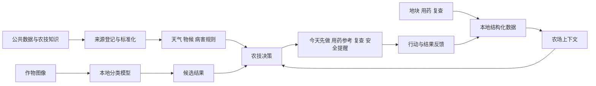

# 项目说明书初稿

## 1. 项目基本信息

| 项目 | 内容 |
|---|---|
| 项目名称 | 农智眼：面向中国-东盟小农户的多源农业数据融合与病虫害智能决策平台 |
| 英文名称 | AgroVision |
| 当前软件版本 | 2.0.0 |
| 参赛组别 | 【待填写：研究生组 / 本科高职组】 |
| 参赛编号 | 【待填写】 |
| 团队与指导教师 | 【待填写】 |

## 2. 问题与用户

小农户发现叶片异常后，通常面临判断慢、农技服务距离远、弱网环境、专业建议难理解和处置过程难追溯等问题。农技员和合作社又缺少统一的地块、问诊、用药与复查记录，难以持续服务和复盘。

项目聚焦三类用户：

| 用户 | 主要任务 | 当前产品能力 |
|---|---|---|
| 小农户 | 快速判断、今天怎么做、何时复查 | 拍照问诊、行动式结果、离线兜底 |
| 农技员/合作社技术员 | 连续跟踪地块和处置效果 | 地块、历史、用药、复查记录 |
| 产销合作社 | 核对用药时间和采收安全信息 | 安全间隔期和采收提醒；双语摘要待实现 |

## 3. 解决方案

核心价值不是单次识别，而是把数据、判断、行动和结果连成可追溯闭环。

## 4. 当前可用功能

- 首页、问诊、农事、我的四个主入口。
- 当前 8 类离线试验分类模型和 Top-3 输出。
- 本地百科检索与农业知识检索。
- 在线 LLM 多轮问答；无 Key 或无网络时使用本地会话与规则。
- 地块、问诊历史、用药记录、安全间隔期和采收提醒。
- 物候与病害气象规则。
- Room 本地存储、JSON 手动备份和隐私同意门槛。

## 5. 核心模块与源代码

| 模块 | 主要路径 | 说明 |
|---|---|---|
| 导航与主流程 | `app/src/main/java/com/agrovision/app/ui/navigation/` | 页面路由与功能开关 |
| 首页 | `ui/screen/home/` | 农户任务入口和农情摘要 |
| 识别 | `ui/screen/detection/`、`ml/` | 图片预处理、ONNX 推理和结果展示 |
| 诊断 | `data/diagnosis/`、`data/repository/DiagnosisRepository.kt` | 本地规则与在线增强 |
| 问农技 | `ui/screen/chat/`、`data/llm/` | 日常对话、多轮上下文和离线兜底 |
| 知识检索 | `data/rag/`、`data/local/encyclopedia/` | 本地百科与搜索 |
| 农事数据 | `ui/screen/farm/`、`data/local/entity/` | 地块和用药记录 |
| 农情顾问 | `data/advisor/`、`domain/advisor/` | 天气、物候和安全提醒 |
| 数据持久化 | `data/local/database/`、`data/local/dao/` | Room 数据库及迁移 |
| 隐私与设置 | `ui/screen/settings/`、`data/local/datastore/` | API Key、隐私同意和配置 |

## 6. 当前边界

- 当前模型只有 8 类输出，不能宣称覆盖 38 类或 120+ 类。
- 害虫检测模型资产未发布。
- 第三方天气 API 不是政府开放数据。
- 账号、云同步、GIS、OCR、巡检、机器人和多智能体实验模块不属于当前交付范围。
- 用药建议是辅助信息，必须以农药登记标签和当地植保要求为准。

## 7. 比赛前最小增强

1. 接入至少一个许可清晰的政府开放数据集。
2. 重训并验证比赛模型，固化数据划分和全部原始指标。
3. 完成真机性能、稳定性和离线流程测试。
4. 完成 5 名农户、2 名农技员、1 名合作社人员的任务测试。
5. 形成一个 2 分钟内可稳定演示的闭环案例。
