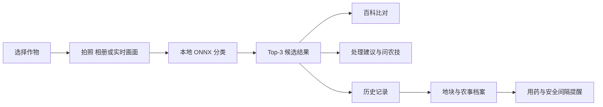
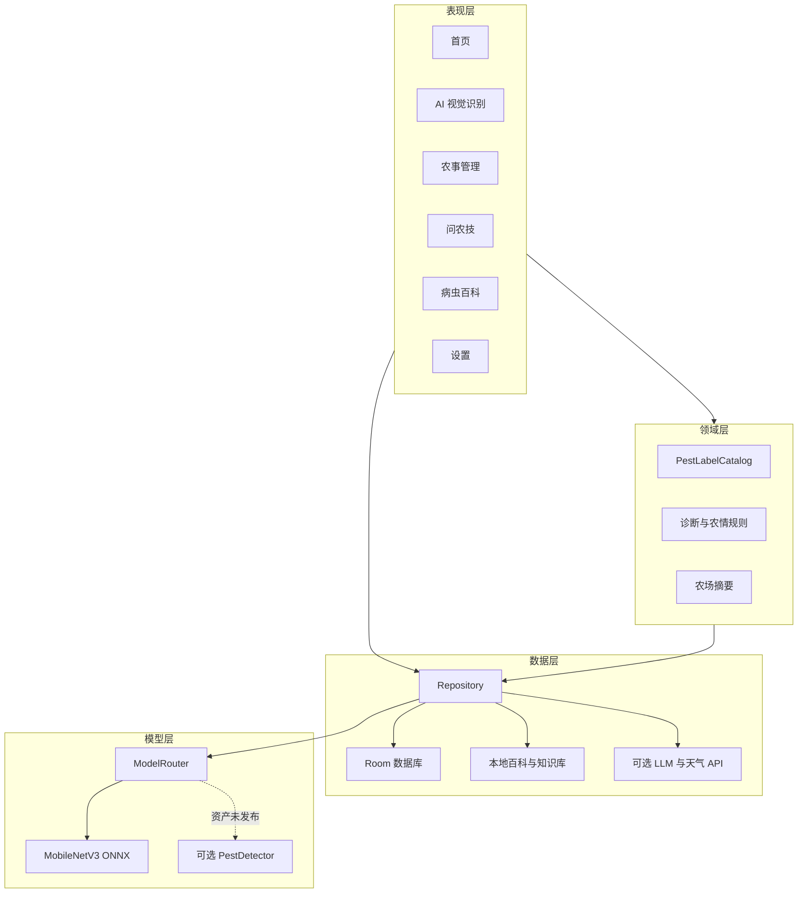

# 农智眼 AgroVision 项目说明书（比赛待提交稿）

> 文档版本：2.0  
> 软件版本：2.0.0（versionCode 20000）  
> 交付日期：2026-08-11  
> 文档状态：比赛待提交稿  
> 适用对象：比赛评审、项目验收与技术复核

## 提交摘要

农智眼 AgroVision 是一款面向小农户和基层农技人员的 Android 作物病害识别与农事决策应用。项目以端侧识别为入口，将病害候选、病虫百科、农技问答、植保配药、农资采购清单、地块用药记录和安全间隔提醒组织为连续业务闭环。

| 提交项 | 内容 |
|---|---|
| 软件版本 | AgroVision 2.0.0 |
| 交付程序 | `AgroVision-2.0.0-debug.apk` |
| APK 大小 | 167,380,866 bytes |
| APK SHA-256 | `8CF551F3CCA6E1B1B11516B57460C58F7FB409CE0C355FF222263D40D586FE86` |
| 识别模型 | MobileNetV3-Small，PlantVillage color 38 类 |
| 数据规模 | 54,305 张彩色叶片图像 |
| 固定测试集结果 | Top-1 99.1808%，Top-3 99.9511% |
| 离线能力 | 图像分类、百科检索、本地问答、农事记录、配药计算与提醒 |
| 构建验证 | `:app:compileDebugKotlin`、`:app:assembleDebug` 均通过 |
| 定向测试 | 13 项通过，覆盖配药、农资目录、离线问答和识别结果策略 |

本次交付 APK 使用 Android Debug 签名，适用于比赛评审安装与现场演示，不作为应用市场发布包。

## 1. 项目概述

### 1.1 项目名称

**农智眼：面向小农户的作物病害识别与农事决策应用**  
英文名称：**AgroVision**

项目展示名称：**面向中国-东盟小农户的多源农业数据融合与病虫害智能决策平台**。

### 1.2 建设背景

小农户和基层农技人员在田间发现叶片异常后，常遇到以下问题：

- 病害初期特征难判断，线下农技服务存在时间和距离成本。
- 田间网络不稳定，完全依赖云端推理会影响可用性。
- 单次识别结果没有和地块、用药、复查记录形成连续档案。
- 农技知识、天气风险、作物物候和农户记录分散，难以形成行动建议。
- 用药和采收缺少安全间隔期提醒，历史过程难追溯。

AgroVision 以 Android 本地应用为载体，把图像识别、病虫百科、农技问答、地块档案、用药记录和本地提醒组织为一条可追溯流程。

### 1.3 建设目标

1. 在弱网或离线环境完成作物叶片图像分类。
2. 把模型结果转换为农户可理解的候选病害和后续行动入口。
3. 通过地块与用药记录形成持续农事档案。
4. 通过本地知识和规则提供基础诊断、搜索和提醒能力。
5. 对数据来源、模型、构建产物和测试证据进行可追溯管理。

### 1.4 本次提交范围

AgroVision 2.0.0 本次提交包含：

- 首页、AI 视觉识别、病虫百科、历史记录、问农技。
- 农事总览、地块管理、植保配药、农资展示目录、用药记录、安全间隔期和采收提醒。
- 农技搜索、本地规则、手动数据备份、主题与隐私设置。
- PlantVillage 38 类 MobileNetV3-Small 离线分类。

以下能力不属于本次提交版本：

- 手机号账号和生产云同步。
- 独立害虫目标检测模型。
- GIS、巡检、告警、OCR、机器人和多智能体平台。
- 应用市场 Release 签名与生产后端服务。

## 2. 用户与使用场景

| 用户 | 典型任务 | 系统支持 |
|---|---|---|
| 小农户 | 发现叶片异常，快速判断并查看处理方向 | 拍照/相册/实时识别、百科、行动式问诊 |
| 农技人员 | 现场辅助诊断，回看历史 | Top-3 候选、知识检索、历史记录 |
| 合作社技术员 | 按地块记录作物、物候和用药 | 农事总览、地块详情、用药时间线 |
| 项目评审人员 | 验证数据、模型、应用和可复现性 | 模型卡、数据台账、测试报告、APK 哈希 |

核心使用流程：



## 3. 系统架构

### 3.1 总体架构

系统采用单 Android 应用、本地优先的分层架构。UI 使用 Jetpack Compose，状态管理采用 MVVM，依赖注入使用 Hilt，业务数据使用 Room，模型推理使用 ONNX Runtime。



### 3.2 分层职责

| 层 | 主要职责 | 代码位置 |
|---|---|---|
| UI | 页面、交互、状态展示、导航 | `app/src/main/java/com/agrovision/app/ui/` |
| ViewModel | 页面状态和协程任务编排 | 各 `ui/screen/*ViewModel.kt` |
| Domain | 标签目录、规则、领域模型 | `domain/` |
| Data | Repository、本地与远程数据访问 | `data/` |
| ML | ONNX/TFLite 推理与模型路由 | `ml/` |
| DI | Hilt 模块和实例生命周期 | `di/` |
| Config | 功能开关和构建配置 | `config/FeatureFlag.kt` |

## 4. 功能说明

### 4.1 AI 视觉识别

识别页面基于 CameraX 和 Compose 实现，支持：

- 相机拍照识别。
- 系统文件选择器相册识别。
- 实时帧分析，默认关闭，由用户主动开启。
- 14 种作物选择和结果过滤。
- 中央取景框、扫描状态和统一底部操作区。
- 本地模型 Top-3 候选结果。
- 结果进入百科或处理建议。

当前 14 种作物：苹果、蓝莓、樱桃、玉米、葡萄、柑橘、桃、辣椒、马铃薯、树莓、大豆、南瓜、草莓、番茄。

### 4.2 病虫百科

- 本地 JSON 知识库，中英文名称检索。
- 症状、原因、传播、防治和用药参考。
- 共 74 个知识条目。
- 其中 26 个条目与当前模型类别准确匹配并使用真实 PlantVillage 示例图。
- App 展示 26 个具备准确类别映射和真实示例图的条目。
- 其余知识条目不进入本次提交版本的百科展示范围，以避免错误配图。

### 4.3 问诊与问农技

- 识别结果按判断程度、危险等级和处理入口组织。
- 可配置第三方 LLM Provider 和 API Key 进行在线增强。
- 无 Key 或网络不可用时，保留本地规则和知识检索。
- 问诊结果可携带病害上下文进入多轮问答。
- 农场摘要可作为对话上下文，但不上传原始图片。

### 4.4 农事管理

农事首页展示：

- 地块数量。
- 已填写总面积。
- 作物种类数量。
- 当前物候记录数量。
- 地块定位完成情况。

地块卡片展示作物、物候、面积、定位和本地/同步状态。地块详情支持用药记录、安全间隔期和预计采收信息。

### 4.5 植保用药

- 从首页、病虫详情或 AI 问诊结果进入，并携带当前病虫害上下文。
- 百科推荐药剂按备选有效成分展示，不默认解释为可混配方案。
- 用户必须填写产品登记标签上的亩用量；系统结合面积、亩用水量和药箱容量计算总药量、总水量、桶数及最后一桶配比。
- 本地农资目录含杀菌剂、杀虫剂、生物制剂和助剂，可搜索、筛选、加入采购清单并复制采购备忘。
- 商城不提供真实支付，商品价格标记为演示参考价。
- 配药结果可预填到地块用药记录，并沿用安全间隔期与采收提醒。

### 4.6 历史与数据管理

- Room 保存识别历史、用户反馈、地块和用药记录。
- 支持收藏、回看和继续诊断。
- 支持本地 JSON 导出/导入。
- 账号和云同步功能开关默认关闭。

### 4.7 农情顾问

- 依据作物与月份提供物候规则。
- 依据天气条件运行病害风险规则。
- 使用 WorkManager 扫描安全间隔期和采收提醒。
- 通知任务只在用户同意隐私条款后注册。

## 5. 数据设计

### 5.1 模型训练数据

| 项目 | 值 |
|---|---|
| 数据集 | PlantVillage color |
| 原始压缩包 | `archive.zip` |
| 压缩包 SHA-256 | `08BF3315BACB7D36F4E37AE47BDAD7562761C261FA2CB0B4BA76CC606C3B912F` |
| 总量 | 54,305 张 |
| 类别 | 38 |
| 划分随机种子 | 20260809 |
| train / val / test | 37,997 / 8,129 / 8,179 |
| 划分方式 | 70% / 15% / 15%，hardlink |

本项目仅使用 `color` 变体。数据划分清单、处理脚本和训练脚本已随项目训练材料归档。

### 5.2 应用数据

| 实体 | 主要内容 |
|---|---|
| `HistoryEntity` | 识别图片路径、候选结果、置信度、时间、收藏 |
| `FeedbackEntity` | 用户对识别结果的正确/错误反馈 |
| `PlotEntity` | 地块、作物、面积、位置、物候、备注、同步状态 |
| `TreatmentEntity` | 药剂、用量、日期、安全间隔期、采收状态 |

应用数据默认保存在本机。卸载、清除应用数据或设备重置可能导致本地数据丢失，用户应主动导出备份。

### 5.3 本次提交的数据来源声明

- 模型训练与测试使用 PlantVillage 开放研究数据集的 `color` 子集；压缩包哈希、划分随机种子、数据量和模型哈希均已记录，便于复核。
- 天气能力通过可选第三方 API 获取，不作为政府开放数据成果申报。
- 百科仅展示具备准确模型类别映射和示例图的条目，防治与用药内容用于信息辅助，不替代农药产品标签和专业农技指导。
- 农户拍摄图片、识别历史、地块和用药记录属于用户生成数据，默认保存在本机且不自动上传。
- 本次提交未将政府开放数据接入列为已交付功能；相关能力作为后续数据协同方向。
- 完整数据血缘、文件哈希和处理过程见 `docs/DATA_PROVENANCE.md`。

## 6. 模型说明

### 6.1 模型结构

| 项目 | 值 |
|---|---|
| 模型 | MobileNetV3-Small |
| 框架 | PyTorch 2.0.1+cpu / torchvision 0.15.2+cpu |
| 输入 | `[1,3,224,224]` |
| 输出 | `[1,38]` |
| ONNX opset | 11 |
| 模型大小 | 6,241,604 bytes |
| ONNX SHA-256 | `41643BD279F3221B810B7500E8596D801ABA2084F93010C687D9F00109F38FCF` |

预处理使用 ImageNet 参数：

```text
mean = [0.485, 0.456, 0.406]
std  = [0.229, 0.224, 0.225]
```

### 6.2 训练策略

1. 使用 ImageNet 预训练权重。
2. 阶段一冻结骨干训练分类头 5 轮。
3. 阶段二载入最佳权重，全量微调至第 8 轮。
4. 学习率 `1e-4`，weight decay `1e-4`，batch size 32。
5. 使用固定随机种子 `20260809`。

### 6.3 测试结果

| 指标 | 结果 |
|---|---:|
| Test loss | 0.0283562078 |
| Test Top-1 | 99.1808% |
| Test Top-3 | 99.9511% |

上述结果来自 PlantVillage 同分布固定测试集，用于说明模型在既定数据划分上的表现。受真实田间光照、背景、拍摄距离和病害阶段差异影响，该结果不等同于生产环境准确率。

### 6.4 模型限制

- 图像分类模型不输出病斑位置框。
- 一张图同时包含多个目标时只给出整图候选类别。
- 受控数据背景和真实田间背景存在域差异。
- 本次识别范围以模型输出的 38 类为准。
- 后续精度提升以补充真实田间数据和外部测试为主要方向，而非单纯增加训练轮数。

## 7. 关键技术

| 类别 | 技术 |
|---|---|
| 开发语言 | Kotlin 2.0.21 |
| UI | Jetpack Compose + Material 3 |
| 架构 | MVVM + data/domain/ui 分层 |
| 依赖注入 | Hilt 2.52 |
| 本地数据库 | Room 2.6.1 |
| 相机 | CameraX 1.4.1 |
| 模型推理 | ONNX Runtime Android 1.17.1 |
| 后台任务 | WorkManager 2.9.1 |
| 网络 | Retrofit 2.9 + OkHttp 4.12 |
| 图片加载 | Coil 2.5.0 |
| 配置 | DataStore + 加密 SharedPreferences |

## 8. 安全与隐私

### 8.1 权限

- 相机：用户进入拍照流程后按用途说明请求。
- 粗略定位：用于天气城市信息，可拒绝。
- 通知：用于农事提醒，由对应功能触发请求。
- 相册选图：使用系统文件选择器，不申请存储权限。

### 8.2 保护措施

- 用户同意隐私条款前不初始化认证和后台提醒。
- Release 禁止明文 HTTP。
- API Key 和 Token 使用加密存储。
- 系统自动云备份关闭，改为用户主动导出。
- 模型在本机推理，原始识别图片默认不上传。
- 缺失 Room 迁移时不允许静默清库。

## 9. 构建与部署

### 9.1 Android 环境

| 项目 | 值 |
|---|---|
| Gradle | 8.9 |
| Android Gradle Plugin | 8.7.0 |
| JDK | 17 |
| compileSdk / targetSdk | 35 / 35 |
| minSdk | 26 |
| applicationId | `com.agrovision.app` |

### 9.2 构建命令

```powershell
.\gradlew.bat :app:compileDebugKotlin
.\gradlew.bat :app:assembleDebug
```

应用市场 Release 构建可通过以下签名项配置：

```properties
KEYSTORE_FILE=...
KEYSTORE_PASSWORD=...
KEY_ALIAS=...
KEY_PASSWORD=...
```

### 9.3 提交安装包

| 项目 | 值 |
|---|---|
| APK 文件名 | `AgroVision-2.0.0-debug.apk` |
| 归档目录 | `submission_materials/20260811_pesticide_center/` |
| 大小 | 167,380,866 bytes |
| SHA-256 | `8CF551F3CCA6E1B1B11516B57460C58F7FB409CE0C355FF222263D40D586FE86` |
| 签名 | Android Debug，APK Signature Scheme v2 |

该 APK 已用于比赛材料归档，可直接安装进行功能评审。其 Debug 签名仅用于本次评审交付，不用于应用市场发布。

## 10. 提交验证结果

### 10.1 构建与功能验证

- 38 类训练、验证和固定 test split 评估。
- ONNX 输入输出与标签数量校验。
- 模型 SHA-256 与 App 资产一致性校验。
- `:app:compileDebugKotlin` 成功。
- `:app:assembleDebug` 成功。
- APK v2 签名校验成功。
- 百科图片映射测试 3 项通过。
- 提交版定向单元测试 13 项通过：`SprayCalculatorTest` 3 项、`PesticideCatalogTest` 3 项、`LocalQuestionMatcherTest` 3 项、`DetectionResultPolicyTest` 4 项。

### 10.2 验证边界

- 模型指标基于 PlantVillage 固定测试集，本次材料不包含真实田间独立测试报告。
- 本次交付以 Debug APK 为评审载体，不包含应用市场 Release/AAB 签名包。
- 本次材料不声明多品牌、多 Android 版本的完整兼容性认证结果。
- 真机推理时延、峰值内存和长时间连续运行数据不作为本次提交指标。
- 在线大模型与天气能力依赖用户配置、第三方服务和网络状态；核心识别、百科、问答降级、农事及植保计算能力可离线使用。

## 11. 项目目录

```text
AgroVision/
├── app/                         Android 应用
│   └── src/main/
│       ├── assets/model/        ONNX 与标签
│       ├── assets/encyclopedia/ 百科示例图
│       └── java/...             Kotlin 源码
├── docs/                        项目、用户、训练与比赛文档
├── tools/                       数据处理、训练和导出脚本
├── competition/                 比赛提交工作区
├── gradle/                      Gradle Wrapper 与版本目录
├── README.md                    项目入口
└── V2.0.md                      V2.0 产品决策与历史规划
```

## 12. 评审演示流程

建议以 2 至 3 分钟展示完整业务闭环：

1. 打开首页，说明本地优先。
2. 进入 AI 视觉识别，选择作物。
3. 从相册选择 PlantVillage 测试图片或拍摄清晰叶片。
4. 展示 Top-3 结果、置信度和百科真实示例图。
5. 从结果页进入植保用药，查看备选有效成分并完成配药计算。
6. 打开农资商城，将示例商品加入采购清单并生成采购备忘。
7. 将配药结果预填到地块用药记录，展示安全间隔期和采收提醒。
8. 进入问农技，展示推荐问题、本地回答以及离线降级能力。
9. 结束时展示数据规模、模型指标、APK 哈希和本地优先架构。

评审演示以本说明书“本次提交范围”为准，GIS、机器人、生产云同步、真实支付和独立害虫目标检测不属于 AgroVision 2.0.0 的交付能力。

## 13. 版本边界与演进方向

| 方向 | 本次提交边界 | 后续演进方向 |
|---|---|---|
| 数据 | PlantVillage color 38 类和本地百科 | 引入合规的田间数据与政府开放数据，完善来源审核 |
| 模型 | 端侧整图分类，输出 Top-3 候选 | 增加田间外部验证、病斑定位和独立害虫检测 |
| 设备验证 | 提供可安装 Debug APK 和定向测试结果 | 补充多机型性能、稳定性与兼容性报告 |
| 服务 | 核心功能本地可用，在线能力按配置启用 | 建设生产级账号、云同步和农技服务后端 |
| 发布 | 比赛评审用 Debug 签名 APK | 配置正式签名并输出 Release APK/AAB |
| 农资 | 本地商品目录、采购清单和演示参考价 | 对接合规供应链、库存与交易服务 |

## 14. 提交材料索引

| 材料 | 用途 |
|---|---|
| `AgroVision-2.0.0-debug.apk` | Android 评审安装包 |
| `docs/PROJECT_MANUAL.md` | 项目定位、架构、功能、数据、模型和验证说明 |
| `docs/USER_MANUAL.md` | 用户操作说明 |
| `docs/DATA_PROVENANCE.md` | 数据来源与血缘 |
| `docs/RELEASE_CHECKLIST.md` | 构建产物与交付核验记录 |
| `competition/03_model/MODEL_CARD.md` | 模型结构、指标和适用边界 |

## 15. 结论

AgroVision 2.0.0 已形成“图像识别、百科比对、农技问答、植保配药、采购清单、农事记录、安全间隔提醒”的完整应用闭环。项目以本地优先架构保障弱网环境下的核心可用性，以数据划分、模型哈希、APK 哈希和测试记录保障交付可追溯性。本说明书所列软件、模型与配套文档共同构成本次比赛待提交版本。
